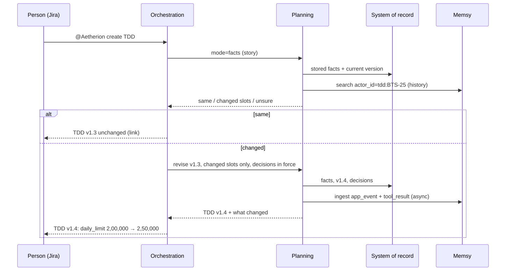
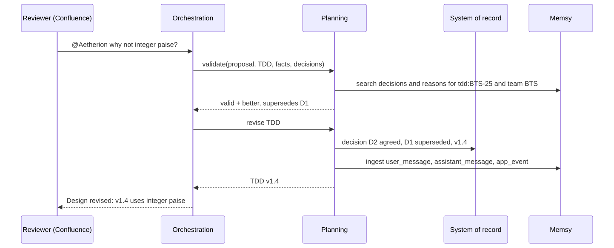

# Planning Agent Memory with Memsy

How the Planning agent should remember requirements, designs and decisions, so that:

1. **The same requirement gives the same TDD**, even when it is reworded ("I am not feeling well" and "I am feeling sick" mean the same thing).
2. **A TDD changes only for a valid modification**: a real change in the requirement, or a requested change that the agent has checked and found correct.
3. **A decision made once is never silently lost** in a later version or by the Coding agent.

This document describes the current architecture, what goes wrong with it in production, the proposed architecture with [Memsy](https://docs.memsy.io/docs), the exact request flows, what we need from Memsy, and the build plan.

Status: proposal, 25 October 2026. Nothing here is built yet.

Diagrams are in [`diagrams/`](diagrams/): an SVG and a PNG per diagram, and the Mermaid source (`.mmd`) to edit them. To re-render after an edit:

```sh
npx -y @mermaid-js/mermaid-cli@11.4.2 -b white -i diagrams/<name>.mmd -o diagrams/<name>.svg
```

---

## 1. Current architecture



<details><summary>Text version</summary>

```text
Jira story comment ──► Orchestration ──► Requirement Review (readiness gate 4/5)
  "@Aetherion create TDD"      │  ▲
                               │  └── readiness score
                               ▼
                        Planning agent ◄──► Neo4j code graph (encrypted)
                               │
                               ▼
                 Confluence TDD page (v1.0, v1.1, ...)
                               │  "@Aetherion why not ... / update the TDD"
                               ▼
                        Orchestration ── "@Aetherion code" ──► Coding agent ──► GitHub pull request
                                                                                    │ merged
                                                                                    ▼
                                                                    Planning refreshes the code graph
```

</details>

| Piece | What it does today |
|---|---|
| Orchestration | Reads Jira and Confluence comments, routes them, posts replies |
| Requirement Review | Scores readiness; a story needs 4/5 before a TDD is written |
| Planning | Searches the encrypted code graph, writes the TDD with Claude (Opus first), answers `why` / `why not` |
| Coding | Implements the TDD and opens a pull request |
| Neo4j | Code graph only (services, files, classes, functions, chunks), encrypted with AES-256-GCM |

### Where state lives today

| State | Where | Limitation |
|---|---|---|
| Code | Neo4j | None |
| TDD text | Confluence page versions | Prose; re-read and re-interpreted on every run |
| Story → TDD link, story fingerprint | Jira issue property `aetherion-tdd` | Exact text hash only |
| Decisions ("money in integer paise") | Nowhere structured | Lost when a version is written fresh |

### How "same story, same TDD" works today (Orchestration 0.1.41)



<details><summary>Text version</summary>

```text
create TDD
    │
    ▼
SHA-256 of story text same as stored?
    ├── yes ──► Return current TDD
    └── no  ──► Revise current TDD, keeping its decisions
```

</details>

### Why this breaks in production

| Situation | What happens today | What should happen |
|---|---|---|
| "I am not feeling well" → "I am feeling sick" | Hash differs → a new version | Same meaning → same TDD |
| A typo fixed, a sentence reordered, a bullet reformatted | New version | Same TDD |
| A comment from a person that adds no new requirement | Counted in the hash → new version | Same TDD |
| "limit 2,00,000" → "limit 2,50,000" | New version (correct) | New version, naming the change |
| `update the TDD: use double for money` | Applied as asked | Checked first: refused, because it contradicts the agreed decision and is less accurate |
| An agreed decision on one story | Not known to the next story | Reused by every design in the project |

The hash compares **characters**. Production needs comparison of **meaning**, plus a check that every change to a TDD is valid.

---

## 2. What Memsy is, and what it is not

Memsy is a hosted memory service for AI agents ([docs](https://docs.memsy.io/docs)). You send **events**; Memsy extracts **memories** from them with an LLM, embeds and indexes them, and lets you search them.

| Concept | Meaning ([Actors and sessions](https://docs.memsy.io/docs/actors-and-sessions)) |
|---|---|
| `actor_id` | Who or what the memory is **about**; stable, max 256 characters; never registered |
| `session_id` | The context window an event belongs to: a conversation, a thread, a job run |
| `kind` | `user_message`, `assistant_message`, `tool_result`, `app_event` (no other values) |
| `content` | The text, under 8,000 characters |
| `metadata` | JSON string, max 4,096 characters; returned as `source_metadata` on search |
| `team_id`, `role_id` | Optional hierarchy: memories can be promoted actor → role → team → org |

Python client (`pip install memsy`):

```python
client = MemsyClient(base_url=os.environ["MEMSY_BASE_URL"], api_key=os.environ["MEMSY_API_KEY"])
client.ingest([EventPayload(actor_id=..., session_id=..., kind="tool_result", content=..., metadata=json.dumps({...}))])
client.search("daily transfer limit", actor_id="tdd:BTS-25", limit=10, threshold=0.0)
client.status(event_ids)          # completed_ids / pending_ids / failed_ids
client.memories.list(actor_id=...) # read-only
```

What the documentation tells us, and what it means for this design:

| Fact from the docs | Consequence |
|---|---|
| `ingest()` returns in about 100 ms; memories are searchable "usually within a few seconds, but there's no guarantee" ([async processing](https://docs.memsy.io/docs/async-processing)) | A `create TDD` reply must not wait on Memsy. Memsy is recall, not the decision point |
| Deduplication is only for identical events within 60 seconds; merging paraphrases is not documented | Memsy will not decide that "not feeling well" equals "feeling sick". **We decide sameness ourselves** |
| Memories cannot be updated or deleted through the API (`clear()` returns 501) | A superseded decision is recorded as a new event; **the authoritative state stays in our own store** |
| Search is semantic, filtered by `actor_id` and `session_id`; no metadata filter is documented | Good for "find similar requirements and decisions"; not for exact lookups |
| Encryption at rest, data residency and retention are not documented | **No source code goes to Memsy.** Only requirement facts, decisions and discussion outcomes, after a security check |

So Memsy is the agent's **long-term, searchable recall**. Our own store stays the **system of record** that decides what the current TDD is.

**Memsy is integrated into the Planning agent only.** Planning holds the Memsy key and makes every Memsy call. Orchestration, Review and Coding never talk to Memsy; they ask Planning through its modes (`facts`, `validate`, `discuss`, design). One key to protect, one place that handles a Memsy outage, and no Memsy code in the other agents.

---

## 3. Proposed architecture



<details><summary>Text version</summary>

```text
Jira story / Confluence TDD page ◄──► Orchestration
                                          │ modes: facts, validate, discuss, design
                                          ▼
┌─────────────── Planning agent (the only Memsy client) ───────────────┐
│  Meaning check ──► Change validator ──► TDD writer ◄──► Neo4j code graph (encrypted)
│  (facts + equivalence judge)      │                                   │
│        │                          │                                   │
│        └──────► Memory manager ◄──┘                                   │
└──────────────────────┬─────────────┬─────────────────────────────────┘
                       ▼             ▼
       System of record (Neo4j,     Memsy (recall: requirements,
       encrypted): facts, TDD       decisions, discussions)
       versions, decisions
```

</details>

| Layer | Store | Holds | Decides |
|---|---|---|---|
| System of record | Neo4j (the same database, encrypted with `CODE_GRAPH_KEY`) | The story's canonical facts, every TDD version and the facts it answered, decisions with status (agreed, superseded) | Which TDD is current; whether a decision is in force |
| Recall | Memsy | Requirement history, decisions and their reasons, discussion outcomes, across all stories | Nothing; it supplies context and similar past cases |
| Code | Neo4j code graph | Encrypted code | Nothing new |

### Memsy mapping

| Memsy field | Our value | Example |
|---|---|---|
| `actor_id` | The TDD of a story (one actor per TDD, as Suhani proposed) | `tdd:BTS-25` |
| `session_id` | One interaction with that TDD: a create or revise run, or a discussion thread on the page | `run:BTS-25:2026-10-23T10:34Z`, `thread:confluence:98123` |
| `team_id` | The Jira project, so decisions can be promoted to the project | `BTS` |
| `kind = user_message` | What a person wrote: the story, a reviewer's comment | "why not use integer paise?" |
| `kind = assistant_message` | The agent's answer | "Agreed: integer paise avoids rounding at 2,00,000" |
| `kind = tool_result` | Structured outputs: the canonical facts, a decision | `{"slot": "daily_limit", "value": "2,00,000 INR"}` |
| `kind = app_event` | Lifecycle: version published, decision superseded | "TDD v1.3 published; decision D2 supersedes D1" |
| `metadata` | `{"story_key", "tdd_version", "page_id", "decision_id", "status", "facts_hash"}` | under 4,096 characters |

---

## 4. Same meaning gives the same TDD

Sameness is decided by **requirement facts**, not by the story's characters. Each step is cheaper than the next, and a changed number always counts as a change.



<details><summary>Text version</summary>

```text
create TDD on a story
    │
    ▼
Normalised text same as stored? ── yes ──► Return current TDD (no AI call)
    │ no
    ▼
Extract canonical facts (Claude, fixed schema)
    │
    ▼
Numbers, dates, amounts or acceptance criteria changed? ── yes ──► Revise only the changed facts,
    │ no                                                            reply names each change
    ▼
Canonical facts identical? ── yes ──► Return current TDD ("reworded, same requirement")
    │ no
    ▼
Equivalence judge: same meaning?
    ├── same, high confidence ──► Return current TDD ("reworded, same requirement")
    ├── different ──────────────► Revise only the changed facts
    └── unsure ─────────────────► Ask the person: keep the TDD or revise?
```

</details>

1. **Normalise and hash** the story: lower case, spacing, punctuation and Jira formatting removed; the agent's own replies and `@Aetherion` requests left out. Same hash → current TDD.
2. **Extract canonical facts** into a fixed schema: actor, rules, limits, acceptance criteria, scope, out of scope. Each fact gets a stable `slot` name and a plain-language `statement`. Numbers, amounts, dates and acceptance lines are copied verbatim.
3. **Hard guard:** any changed number, date, amount or acceptance line is a real change. No AI judgement.
4. **Identical facts** → the story was reworded. Current TDD, and the reply says so.
5. **Equivalence judge:** for facts whose wording differs, Claude compares the old and new statements and answers `same`, `different` or `unsure`, with a reason. "Not feeling well" vs "feeling sick" → `same`. "Successful transfers count" vs "all transfers count" → `different`.
6. **Unsure** → the agent asks instead of guessing: "The wording of rule 2 changed. Reply `keep` to keep TDD v1.3, or `update the TDD` to revise it."

Memsy's part: before step 5, the agent searches `actor_id = tdd:<story>` for the earlier facts and the discussion behind them, so the judge sees why each fact was written the way it was.

---

## 5. A TDD changes only for a valid modification

Every request to change a TDD goes through the **change validator** before anything is written.



<details><summary>Text version</summary>

```text
Comment on the TDD page
    │
    ▼
What kind?
    ├── question ("why this?") ──► Answer from decisions + code, no change
    └── proposal ("why not X?" / "update: X")
            │
            ▼
        Consistent with the story's facts? ── no ──► Refuse, explain which fact it breaks
            │ yes
            ▼
        Technically sound for this code? ──── no ──► Refuse, explain with the code
            │ yes
            ▼
        Conflicts with an agreed decision?
            ├── yes ──► Clearly better than that decision?
            │              ├── no  ──► Refuse, cite the decision
            │              └── yes ──► Supersede the decision ──► Revise the TDD
            └── no  ──► Already in the TDD?
                           ├── yes ──► No new version: say where it is
                           └── no  ──► Revise the TDD
                                          │
                                          ▼
                     Record: new version, decision, reason (system of record + Memsy)
```

</details>

| Request | Result |
|---|---|
| `why this approach?` | Answer only |
| `why not integer paise?` (better) | Decision "money as integer paise" agreed, supersedes "double"; TDD revised; both recorded |
| `why not a separate table?` (worse here) | Refused with the reason; no new version |
| `update the TDD: use double for money` | Refused: breaks the agreed paise decision and is less accurate |
| `update the TDD: also log each rejected transfer` (new, sound, no conflict) | Applied; new version |
| `update the TDD: add the daily limit check` (already there) | No new version; the reply points to the section |
| A mix of valid and invalid points | The valid points are applied, the rest are refused one by one with reasons |

A person who still wants a refused change can insist explicitly (`update the TDD anyway: …`). That is recorded as a human override, with their name.

---

## 6. End-to-end flows

### Create TDD



<details><summary>Text version</summary>

```text
Person (Jira)    Orchestration        Planning            System of record     Memsy
     │ create TDD ──►│                    │                      │                │
     │               │── mode=facts ─────►│                      │                │
     │               │                    │── stored facts ─────►│                │
     │               │                    │── search history ─────────────────────►│
     │               │◄─ same / changed / unsure                 │                │
  if same:           │                    │                      │                │
     │◄─ "TDD v1.3 unchanged" (link)      │                      │                │
  if changed:        │── revise v1.3 ────►│                      │                │
     │               │                    │── facts, v1.4, decisions ─►│          │
     │               │                    │── ingest events (async) ──────────────►│
     │               │◄─ TDD v1.4 + what changed                 │                │
     │◄─ "TDD v1.4: daily_limit 2,00,000 → 2,50,000"             │                │
```

</details>

### Discussion on the TDD page



<details><summary>Text version</summary>

```text
Reviewer (Confluence)   Orchestration          Planning            System of record     Memsy
     │ why not integer paise? ──►│                  │                      │                │
     │                           │── validate ─────►│                      │                │
     │                           │                  │── search decisions (story + team) ───►│
     │                           │◄─ valid, better, supersedes D1          │                │
     │                           │── revise TDD ───►│                      │                │
     │                           │                  │── D2 agreed, D1 superseded, v1.4 ─►│  │
     │                           │                  │── ingest comment, answer, event ──────►│
     │                           │◄─ TDD v1.4       │                      │                │
     │◄─ "Design revised: v1.4 uses integer paise"  │                      │                │
```

</details>

### A new story in the same project

Planning searches Memsy with `team_id = BTS` for decisions on the same services ("money as integer paise"), checks each one is still agreed in the system of record, and gives the agreed ones to the TDD writer as constraints. The first version of the new TDD follows them.

### Coding

Coding receives the decisions in force for the files it edits, from the system of record. An edit that contradicts one goes back to Planning instead of into the pull request.

---

## 7. What we need from Memsy

Before production use, confirm these with the Memsy team:

| Need | Why | Documented? |
|---|---|---|
| Encryption at rest and in transit, data residency, retention period | Requirement text and decisions are company data | No |
| A delete API (per actor and per memory) | `clear()` returns 501; we must be able to remove a project's data | No |
| Whether paraphrased memories are merged, and how | Avoid duplicate and conflicting recalls | No |
| A way to mark a memory superseded (`effective_to`, `status: archived`) through the API | Old decisions must stop being recalled as current | Fields exist; no write path documented |
| Metadata filters in search (`story_key`, `status`) | Exact recall per TDD version | No |
| Processing latency target | We design for "eventually searchable" | "No guarantee" |
| Rate limits and price for our volume | Each TDD run writes about 5 to 20 events | Plans only |
| Self-hosting or a dedicated region | Alternative if the security answers are not enough | `MEMSY_BASE_URL` override mentioned |

Setup from our side: one Memsy org per environment (test, production), an API key in the Planning agent's secret store only (`MEMSY_API_KEY`, `MEMSY_BASE_URL`, never in code), and one team per Jira project.

---

## 8. Components to build

| Component | Agent | Purpose |
|---|---|---|
| `src/memory/facts.py` | Planning | Canonical fact extraction (fixed schema, verbatim numbers) and normalised hashing |
| `src/memory/equivalence.py` | Planning | The hard guard and the equivalence judge (`same` / `different` / `unsure`) |
| `src/memory/validator.py` | Planning | The change validator (section 5) |
| `src/memory/record.py` | Planning | System of record in Neo4j: facts, versions, decisions; encrypted |
| `src/memory/memsy_store.py` | Planning | Memsy ingest and search, with timeouts; a Memsy failure never fails a run |
| `mode: "facts"`, `mode: "validate"` | Planning | New agent modes Orchestration calls |
| `create_tdd`, `design_question`, `update_tdd` | Orchestration | Call `facts` / `validate` first; refuse, keep or revise accordingly |
| Decision guard | Coding | Receives the decisions in force inside the TDD Planning hands over; no Memsy or database access of its own |
| `ORCH_MEMORY` = `off` / `shadow` / `on` | Orchestration | Switches the new behaviour on step by step |

---

## 9. Build plan

| Phase | Work | Done when |
|---|---|---|
| 1. Meaning check (4 days) | facts.py, equivalence.py, record.py; Planning `mode: facts`; Orchestration `create_tdd` uses it, in `shadow` first | A reworded BTS-25 ("limited to" → "capped at") returns the same version; a changed limit revises and names it; "unsure" asks |
| 2. Change validator (3 days) | validator.py; `why not` and `update the TDD` go through it | `update the TDD: use double` is refused; `why not paise` is applied once; a duplicate request makes no version |
| 3. Memsy recall (3 days) | memsy_store.py; ingest after each run; search before the judge and the validator; team-level search for new stories | A new money story's v1.0 uses paise from BTS-25's decision; Memsy down → runs still complete |
| 4. Coding guard and rollout (2 days) | Decisions into Coding; backfill existing TDDs; `ORCH_MEMORY=on` | A Coding change that sums money as `double` is sent back |

Total: about 12 working days. Phase 3 starts only after the security answers in section 7.

### Acceptance tests

| Input | Expected |
|---|---|
| Same story, asked twice | Same version, no Planning run |
| "I am not feeling well" → "I am feeling sick" in a story | Same version, "reworded, same requirement" |
| 2,00,000 → 2,50,000 | New version naming `daily_limit` |
| "successful transfers" → "all transfers" | New version naming the rule |
| A wording change the judge is unsure about | The agent asks; no version until answered |
| `update the TDD` with an invalid change | Refused with the reason; no version |
| `update the TDD` with a valid change | New version; decision recorded |
| Memsy unavailable | Runs complete from the system of record; recall skipped and logged |

---

## 10. Risks

| Risk | Mitigation |
|---|---|
| The judge calls a real change "same" | Numbers, dates, amounts and acceptance lines are never judged, only compared; low confidence asks the person |
| The judge calls a rewording "different" | Costs one extra revision, which keeps all decisions; the reply says what it thinks changed, so a person can correct it |
| Memsy recalls a superseded decision | Every recalled decision is checked against the system of record before use |
| Company data in a third-party service | Only facts and decisions, never code; phase 3 waits for the security answers |
| Memsy latency or outage | Recall is optional; ingest is fire-and-forget with `status()` checked later |
